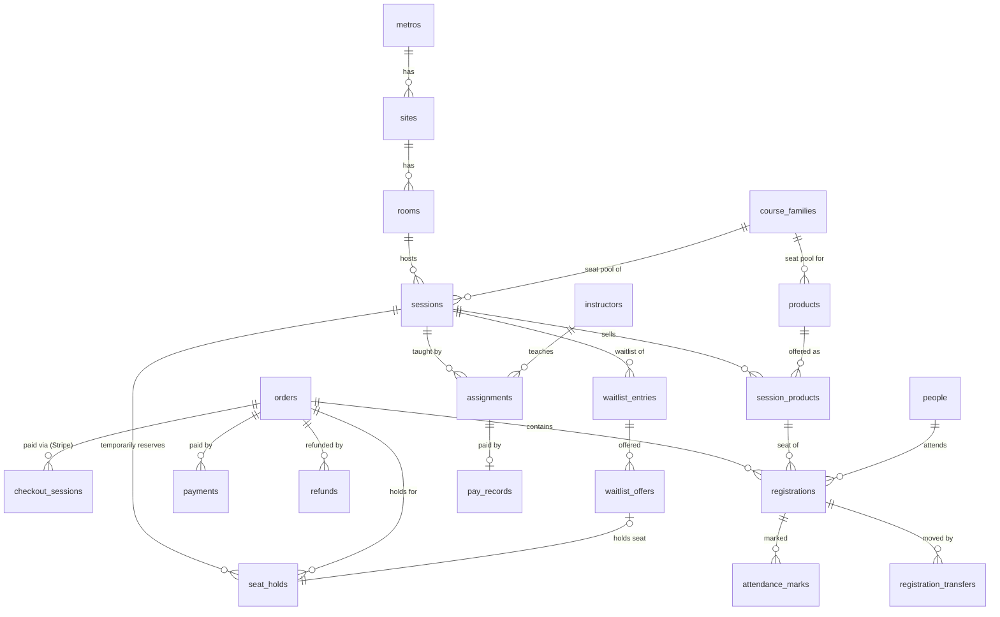

# Database architecture

PostgreSQL 16 (Replit PostgreSQL). The schema is in
[`db/schema.sql`](../db/schema.sql), reference data in
[`db/seed.sql`](../db/seed.sql), and checks in [`db/tests/`](../db/tests/).
What the engine keeps from each outside platform, and why, is in
[`source-of-truth.md`](source-of-truth.md).

The database is created and changed by the Alembic migrations in
[`migrations/`](../migrations/) (`flask --app wsgi db upgrade`). Migration
0001 is `schema.sql` and 0002 is `seed.sql`, frozen as of Oct 19, 2026.
`schema.sql` stays the readable picture of the whole current database: every
later migration updates it too, and `db/tests/migrations_match.sh` checks
that the two agree.

## Table map

59 tables and 6 views, in 14 groups:

| Group | Tables | Owner |
|---|---|---|
| Accounts, roles, permissions | `user_accounts`, `user_identities`, `roles`, `permissions`, `role_permissions`, `user_roles` | Engine (staff sign-in identity from Entra) |
| Settings and policies | `app_settings`, `policy_versions` | Engine |
| Catalog | `airtable_records`, `metros`, `sites`, `site_private_details`, `rooms`, `room_course_families`, `course_families`, `products` | Mirror of Airtable |
| Classes and seats | `sessions`, `session_airtable_records`, `session_private_details`, `session_products`, `external_seat_reservations`, `seat_overrides` | Airtable schedule, engine capacity |
| People | `people` | Mirror of GHL contacts |
| Orders and checkout | `orders`, `order_attribution`, `seat_holds`, `checkout_sessions` | Engine + Stripe IDs |
| Waitlist | `waitlist_entries`, `waitlist_offers` | Engine |
| Registrations | `registrations`, `registration_transfers` | Engine (+ GHL opportunity ID) |
| Money | `payments`, `refunds` | Engine amounts, Stripe IDs |
| Instructors | `instructors`, `instructor_certs`, `cert_type_course_families`, `instructor_equipment`, `availability_blocks`, `time_off`, `rate_card`, `class_offers`, `class_offer_requests`, `assignments`, `pay_records`, `attendance_marks` | Engine (from portal launch) |
| Consent and notes | `consent_records`, `notes` | Engine |
| Sign-in | `auth_sessions`, `action_tokens` | Engine |
| Integration ledger | `oauth_connections`, `ghl_stage_map`, `webhook_events`, `outbox_jobs`, `integration_runs`, `integration_issues`, `notifications` | Engine |
| Public site | `page_content`, `url_redirects` | Engine |
| Audit | `audit_log` (append-only) | Engine |

Views: `user_effective_permissions` (what each account may do), `session_availability` (live seats), `waitlist_queue` (positions),
`session_break_even`, `unsynced_items` (the console's unsynced list),
`sessions_needing_instructor` (coverage board).

## Accounts, roles and dashboards

Everyone who signs in has one `user_accounts` row: customers, instructors
and office staff alike. There is one sign-in page and nobody picks a role:
what a person may do comes only from the roles granted to them in
`user_roles`. The role with the lowest `roles.sort_order` is their main one
and decides what they see first. Which dashboard area opens comes from the
role data too: a staff role (`roles.is_staff`) opens the admin area, a role
whose `dashboard_key` is `instructor` opens the instructor area, everyone else
the student area. Inside the admin area each tab needs its own permission.

- **How people get roles.**
  - **Every new account** starts as a regular **user**.
  - **Paying for a seat** makes them a **student**. A trigger on
    `registrations` grants it when a booking under their email is confirmed.
    Someone who booked as a guest becomes a student when they create an
    account, via `grant_student_role_if_booked()`.
  - **Instructor and staff roles** are granted from the admin dashboard by
    someone with `user.manage`; only an admin can grant or revoke the Admin
    role. The very first admin of a database is made from the shell with
    `flask --app wsgi users make-admin EMAIL`.
  - **"I'm an instructor" at sign-up** is saved as
    `user_accounts.signup_intent` for the team to verify. It grants nothing
    on its own.
- **Booking doesn't need an account.** Guests can still check out.
- **Sign-in methods** are per account in `user_identities`:
  - **Email and password** for everyone. Only a salted scrypt hash is stored.
    The sign-in locks for 15 minutes after 5 wrong passwords.
  - **Microsoft 365 for staff and emailed one-time links** come later.
  - One person can have several sign-in methods.
- **City-area limits.** A role grant can be limited to one city area
  (`user_roles.scope_metro_id`), e.g. a manager for Houston only. A limited
  grant never satisfies a check for another area or for all areas.
- **Permissions** are named actions (`booking.transfer`,
  `refund.approve_large`, ...). `user_has_permission(user, permission,
  city_area)` is the single check the app uses; the database itself uses it
  for extra seats and large refunds.
- **Instructor permissions** (`own.*`) cover only that instructor's own
  classes and pay. The app filters by their assignments.
- **Lead vs helper instructor is not a role.** It is the job held in one
  class (`assignments.role`). Both get the same `instructor` role and the
  same view of that class; the differences are in how they are assigned, the
  seats a helper adds, and the pay rate.
- **History.** Revoking a role sets `revoked_at` (kept for history) and takes
  effect immediately. Suspending an account removes all its permissions. The
  audit log records the role each action was taken from.
- **Changing what a role can do** is the Roles & permissions tab, which needs
  `role.manage` (added in migration 0003). The Admin role always has every
  permission, so it has nothing to tick.

| Role | Dashboard for | Signs in with | Can do |
|---|---|---|---|
| Admin | Owner / system admin | Microsoft | Everything, including people, roles, settings and pay approval |
| Manager | CS leads | Microsoft | Everything customer service can, plus large refunds, extra seats over the limit, private class details, attendance on any class, audit log, reports, resolving data problems, approving page wording |
| Customer service | CS team | Microsoft | Find classes and students; phone and invoice bookings; transfer (single and whole class); cancel; refund within policy; edit details; notes; waiting lists; unsynced list |
| Operations | Teaching operations | Microsoft | Post classes to instructors, approve who teaches, add/remove helpers, manage instructors, coverage board and alerts, private class details, export class lists, sync now, page wording, data problems, see all pay |
| Helper instructor recruiting | Helper search team | Microsoft | Gets helper-demand alerts; sees classes, waiting lists, instructors, coverage |
| Second-class approver | Location approvals | Microsoft | Gets second-class alerts; sees classes and waiting lists |
| Viewer | Read-only overview | Microsoft | Sees classes, waiting lists, coverage, reports and system health |
| Instructor | Teachers (lead or helper) | Email + password | Own classes only: request and release classes, class list and private details, check-in and marks, export class list, availability, certifications, pay |
| Student | Customers who have booked (automatic) | Email + password | Their bookings, receipts and certificates; book more; manage their profile |
| User | Every account (automatic) | Email + password | Book classes; manage their profile |

The full permission list (50) and the role grants are in `db/seed.sql`, so
changing who can do what is a data change, not a code change.

## Core relationships



**A session is one physical class**: one room, one time and one seat pool.
A&P and Adult are two `products` in the FA/CPR/AED `course_family`, both
offered through `session_products`, so both take seats from the same session.
Composite foreign keys make it impossible to sell a product from a session of
another seat pool or delivery mode.

**A registration is one seat for one named attendee**, and maps to one GHL
opportunity. A 3-seat employer order is one `orders` row, one `seat_holds` row
of quantity 3, and three `registrations`.

## Lifecycles

**Registration** (`registrations.status`) and the GHL stage it maps to through
`ghl_stage_map`:

| Status | Takes a seat? | Meaning | GHL state |
|---|---|---|---|
| `pending` | Through its hold | In an active checkout or payment-link hold | none yet |
| `awaiting_payment` | Yes | Invoice / PO booking, money due by `orders.invoice_due_on` | booked |
| `confirmed` | Yes | Paid | booked ("Pending" stage today) |
| `displaced` | No | NBC cancelled the class; waiting for transfer or refund | displaced |
| `completed` | Yes | Attended, marked Complete | completed |
| `no_show` | Yes | Marked No Show | no_show |
| `cancelled` | No | Cancelled; refunded per policy, or not | cancelled |
| `forfeited` | No | Fee lost (under 24 hours' notice, late arrival). A 50%-off rebooking links back through `rebooked_from_registration_id`. | cancelled |
| `expired` | No | Hold lapsed unpaid | none |

A transfer changes `session_id` (and possibly `product_id`) on the same row,
so the GHL opportunity follows the student. Each move is logged in
`registration_transfers` with its fee, price difference and rule. "Only one
transfer per student" is counted from that table by reason.

**Seat hold** (`seat_holds.status`): `active` → `converted` (paid),
`released` (cancelled by the engine) or `expired`. An active hold stops
counting the moment `expires_at` passes, even before the expiry job runs.

**Waitlist entry**: `waiting` → `offered` → `converted` / `offer_expired`
(keeps its place, not re-offered automatically) / `removed` /
`closed_no_seat` (cut-off notice sent).

## What the database guarantees on its own

These hold however the code is written. Each is covered by
`db/tests/schema_checks.sql` or `db/tests/last_seat_race.sh`.

| Rule from the plan | How it's enforced |
|---|---|
| A class is never oversold (13th seat refused) | Deferred constraint triggers on holds, registrations, overrides and capacity lock the session row (`FOR NO KEY UPDATE`) and recount at commit. Tested with 40 concurrent buyers. |
| A&P and Adult share one pool at their own prices | `session_products` with composite FKs to `sessions` and `products` |
| Expired holds release their seats | Seat count ignores holds past `expires_at` |
| Class max never above the room's Max Student Count; never below seats sold | CHECK on `sessions`; capacity trigger |
| Co-instructor only at co-instructor locations; one lead, at most one co per class | Trigger on `assignments`; partial unique index |
| An instructor can't teach overlapping classes | Exclusion constraint on `assignments.session_range`, kept in step on reschedule |
| A cancelled class frees its instructors | Trigger on `sessions.status` |
| Two live classes can't share a room at the same time | Exclusion constraint on `sessions` |
| A metro is on Enrollware or the engine, never both | Holds and registrations refused unless the metro's `booking_system = 'engine'` |
| Public and phone sales only for published classes, before sales close | Trigger on `seat_holds` |
| An offered waitlist seat never returns to public sale | Every seat offer must carry a hold from the moment it is queued |
| Waitlist list size, including groups | Deferred trigger on `waitlist_entries` against `sessions.waitlist_limit` |
| Enrollware seats count against capacity | Included in the seat count. Recorded even if they overfill a class, which then sells nothing more. |
| Manager-only overrides and large-refund approvals | Permission check (`user_has_permission`, city-area aware) on `seat_overrides` and `refunds` |
| A Stripe price can't disagree with the displayed price | CHECK on `products` and `session_products` |
| Each attendee in an order has their own email (else GHL merges contacts) | Unique `(order_id, attendee_email)` |
| A person holds at most one live seat per class | Partial unique index |
| Each webhook event processed once | Unique `(provider, event_id)` |
| Customer messages always go through GHL | CHECK on `notifications` |
| The audit log can't be changed | Triggers block UPDATE, DELETE, TRUNCATE |
| Roles are granted and revoked only by people allowed to (`user.manage`); only an admin grants or revokes Admin; Student and User are never granted by hand | Trigger on `user_roles` (`trg_user_roles_guard`); grants with no granter are system grants (sign-up, paid seat, first-admin command) |
| There is always at least one active admin | Triggers on `user_roles` revokes and `user_accounts` status changes (`trg_keep_an_admin`) |
| Private class-packet data never reaches public queries | Kept in separate `*_private_details` tables |

## How the app uses it

**Booking a seat** (one transaction, then Stripe):

```sql
SELECT ... FROM sessions WHERE id = $1 FOR NO KEY UPDATE;   -- queue concurrent buyers
SELECT session_seats_available($1);                          -- enough seats?
INSERT INTO orders ...; INSERT INTO seat_holds ...;          -- expires_at = now() + 15 min
INSERT INTO registrations (status 'pending') ...;            -- one per named attendee
COMMIT;
-- then create the Stripe Checkout session (hold public_id in metadata)
```

Use `FOR NO KEY UPDATE`, not `FOR UPDATE`. `FOR UPDATE` conflicts with the
key-share locks that foreign-key inserts take, and concurrent buyers deadlock.
The race test caught this.

**Stripe webhook**: insert into `webhook_events` (a duplicate means it was
already handled), then in one transaction: registrations → `confirmed`, hold →
`converted`, order → `paid`, `payments` row, and the GHL outbox jobs. If the
hold had lapsed: check seats. Confirm if one is free, otherwise refund
(`refunds.source = 'engine_auto'`) and raise an `integration_issues` row.

**Outbox**: every change another platform must hear about writes an
`outbox_jobs` row in the same transaction. Workers claim rows with
`FOR UPDATE SKIP LOCKED`, call the API with the row's idempotency key, and
retry with backoff. Failures appear in `unsynced_items`.

**Airtable sync**: one savepoint per record. Changes the database refuses are
logged to `integration_issues` instead of aborting the batch. Examples: a seat
cap below seats sold, a reschedule that would clash an instructor, two classes
in one room. The sync never lowers `capacity` while `capacity_basis =
'co_instructor'`.

**Background jobs**: hold expiry, waitlist dispatch (8 AM–6 PM local) and
cut-off, coverage alerts (21/14/7 days), GHL and Stripe reconciliation,
sitemap rebuild, Enrollment Snapshot push, and data retention. Each logs to
`integration_runs`.

## Data retention (proposed)

| Data | Kept | Setting |
|---|---|---|
| `orders.client_ip`, `client_user_agent` | 90 days | `retention_days_client_ip` |
| `webhook_events.payload` | 30 days (row kept for dedupe) | `retention_days_webhook_payload` |
| `auth_sessions`, used/expired `action_tokens` | Deleted after expiry | — |
| Everything else | Kept (bookings and money are business records) | — |

## Open questions that affect the schema

These are modelled so either answer fits, but someone has to decide.

1. **What makes a co-instructor location?** Plan §9d says the room holds more
   than one instructor's max. Waitlist rules §2 say the space above the max
   must reach break-even. The schema stores `sessions.location_type`, which
   the engine computes; it needs the rule. *(Jennifer, Bre)*
2. **Break-even price for a class selling A&P ($108) and Adult ($88).** The
   view uses the lowest price, which is conservative. *(Jennifer, Bre)*
3. **Price source per class.** Fixed Course Master price, or a per-class or
   per-location field? The rules say prices vary by location. *(Jennifer, Bre)*
4. **Large-refund threshold** for manager approval. It isn't in the Oct 14
   policy (`app_settings.large_refund_threshold_cents`). *(Jennifer)*
5. **Where rooms come from.** Is each Master Locations record one room, or
   does Airtable name rooms inside a location? Houston had 8 locations and
   24 rooms in the GHL build. *(Bre)*
6. **Do "Offer expired" students count toward waitlist size?** Currently no.
   *(Jennifer, Bre)*
7. **One email per attendee.** GHL merges contacts by email. Employer orders
   must give each attendee their own email, and the checkout form will say
   so. *(Jennifer)*
8. **Rosters for mixed classes.** Instructors of a Richmond class with
   Enrollware students after Jan 11 see only engine students in the portal.
   *(Bre, Christopher)*
9. **GHL "Pending" stage** is used for both new bookings and students moved
   out of a cancelled class. A separate stage would let GHL workflows tell
   them apart. `ghl_stage_map` supports either. *(Jennifer)*
10. **Who gets which role.** The plan names Jennifer (owner), Bre (operations
    lead) and the CS team but not their system roles. Suggested: Jennifer
    admin; Bre admin or manager + operations; CS team customer service;
    Amanda viewer. Also: which roles should be limited to one city area as
    more cities launch. *(Jennifer)*
11. **Extra webhooks** beyond the plan's list: Stripe `charge.refunded` and
    `charge.dispute.created` (Dashboard refunds, chargebacks), and GHL
    `ContactDelete`. Recommended. *(Christopher)*

## Running the checks

```bash
flask --app wsgi db upgrade                                                 # empty database
psql "$DATABASE_URL" -v ON_ERROR_STOP=1 -f db/tests/schema_checks.sql      # 45 checks, rolled back
DATABASE_URL=postgresql:///postgres db/tests/last_seat_race.sh 40 12      # concurrent buyers
```
